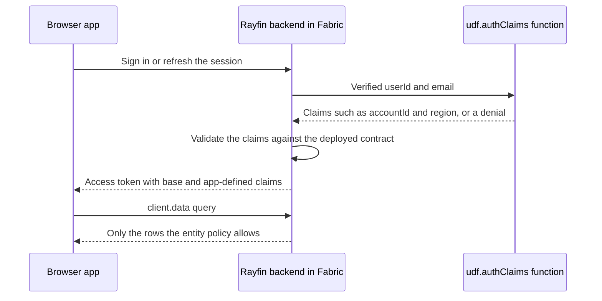

[New in 2.0](/docs/reference/changelog#rayfin-20)

Use dynamic auth claims when your entity policies need facts about the signed-in user that
Microsoft Entra ID does not provide — the customer account they belong to, their region, or
a support role. You write one `udf.authClaims` function. Rayfin calls it every time it mints
an access token for a user, at sign-in and at refresh, and adds the values it returns to the
token. [Entity policies](/docs/data/permissions) then compare `claims.<name>` to fields on
each row.

> [!NOTE]
> Dynamic auth claims are generally available, but the Rayfin backend must have them enabled
> for your workspace's region. Until it does, sign-in and refresh mint only the base claims
> (`sub`, `email`, `role`) and never call your function.
> The claims function is a Rayfin Function, and Functions are not available in every Fabric
> region or tenant.

## How dynamic claims work



- The backend calls the function before any Rayfin token exists for the user, so the
  function has no data client and no connections.
- Issuance fails closed. If the function throws, returns nothing, or returns claims that do
  not match the deployed contract, no token is minted and sign-in or refresh fails.
- New claims take effect the next time a token is minted. See
  [Pick up changed claims](#pick-up-changed-claims).

## Enable dynamic claims

Declare `services.auth.dynamicClaims` and enable Functions in `rayfin/rayfin.yml`:

```yaml title="rayfin/rayfin.yml"
services:
  auth:
    enabled: true
    allowedRedirectUris:
      - http://localhost:5173
    fabric:
      enabled: true
    dynamicClaims:
      enabled: true
  functions:
    enabled: true
    auth:
      type: application
```

`services.auth.dynamicClaims` is the only switch. Declaring it turns on claim code generation
for the project, and `enabled` is the per-app setting the backend reads at sign-in. With
`enabled: false`, Rayfin still generates and deploys your function and its contract, but the
backend does not call it — use that to stage a function before you turn it on.

No feature flag is involved. If `RAYFIN_FEATURE_FLAGS` contains `dynamicclaims` while
`rayfin.yml` does not declare `services.auth.dynamicClaims`, the CLI stops with an error that
tells you to declare `services.auth.dynamicClaims` and remove `dynamicclaims` from
`RAYFIN_FEATURE_FLAGS`.

If the project has no Functions yet, create the functions project first:

```bash
npx rayfin functions init
```

## Write the claims function

Register exactly one `udf.authClaims` function. This one looks the user up in an external
entitlements API, denies users who have no entitlement, and fails on any other error:

```typescript title="rayfin/functions/src/function_app.ts"
import {
  UserDataFunctions,
  type AuthClaimsContext,
} from '@microsoft/fabric-user-data-functions';

const udf = new UserDataFunctions();

interface Entitlement {
  accountId: string;
  region: string;
  canExport: boolean;
}

udf.authClaims(
  async (
    ctx: AuthClaimsContext,
  ): Promise<{ accountId: string; region: string; canExport: boolean }> => {
    const apiKey = ctx.getSecret('ENTITLEMENTS_API_KEY');
    if (!apiKey) {
      throw new Error('The entitlements API key is not configured.');
    }

    const response = await fetch(
      `https://entitlements.example.com/users/${encodeURIComponent(ctx.auth.userId)}`,
      { headers: { Authorization: `Bearer ${apiKey}` } },
    );
    if (response.status === 404) {
      ctx.denySignIn('You do not have access to this app. Ask your administrator for an account.');
    }
    if (!response.ok) {
      throw new Error(`Entitlements lookup failed with status ${response.status}.`);
    }

    const entitlement = (await response.json()) as Entitlement;
    return {
      accountId: entitlement.accountId,
      region: entitlement.region,
      canExport: entitlement.canExport,
    };
  },
);
```

Store the API key as an app secret with `npx rayfin secret set ENTITLEMENTS_API_KEY`. See
[Secrets](/docs/functions/secrets).

Look the user up by `ctx.auth.userId`, which is stable, or by a normalized `ctx.auth.email`.
Never accept an identity or entitlement that the caller supplies, and never log either
identity field. Throw on a missing entitlement, a failed read, a timeout, or an unexpected
response — never fall back to broad default claims.

### What the function can use

The function receives an `AuthClaimsContext`, not a `RayfinContext`:

| Member | Description |
| --- | --- |
| `ctx.auth.userId` | The user's subject ID — the same value as the base `sub` claim. Verified by the host and read-only. |
| `ctx.auth.email` | The user's email address. Verified by the host and read-only. |
| `ctx.getSecret(name)` | Reads an app secret, for example a key for an external entitlements system. |
| `ctx.denySignIn(reason?)` | Refuses this sign-in on purpose. See [Deny a sign-in](#deny-a-sign-in). |
| `ctx.sql` | Present only when you annotate the context `AuthClaimsContext & WithSql`. See [Entitlements in the app database](#entitlements-in-the-app-database). |

`ctx.auth` has no `role`: Rayfin's base role is a platform class, not an app entitlement. The
context has no `getDataClient()`, `getClaims()`, `Tokens`, `accessToken`, `baseUrl`, or
`publishableKey`, and `udf.authClaims` does not accept connection declarations.

### Claim rules

The CLI checks the function when it generates types, and the backend checks every result at
sign-in:

| Rule | Detail |
| --- | --- |
| One function | At most one `udf.authClaims` per app. A second registration fails. |
| Inline handler | Pass the function inline, as in `udf.authClaims(async (ctx) => { ... })`. A named function or variable is rejected at build time, the same rule as `udf.func`. |
| Explicit, closed return type | Declare the return type. It must be an object of at most 8 required `string`, `number`, or `boolean` properties. A literal union of one scalar type, such as `'free' \| 'pro'`, is widened to that type. Optional properties, `null`, mixed unions, arrays, nested objects, and index signatures are rejected. |
| Names | Each name matches `^[A-Za-z][A-Za-z0-9_]*$`, is at most 64 bytes, and differs from the others by more than case. |
| Reserved names | `sub`, `email`, `role`, `sid`, `iss`, `aud`, `exp`, `iat`, `nbf`, `jti`, `name`, and `scope`, and names starting with `dc_`, `rfn_`, or `xms_`, compared case-insensitively. |
| Static claims | A name must not match a static claim in `services.auth.customClaims`. `rayfin up` and `rayfin dev` reject the overlap. |

## Deny a sign-in

Call `ctx.denySignIn(reason)` to refuse a user on purpose — for example, someone with no
entitlement or not on a staff list. Use a plain `throw` for lookup failures, so a deliberate
denial stays distinguishable from a broken function.

- The backend answers the sign-in with HTTP 403 and mints no token.
- The reason can be shown to the user, so keep secrets and other users' data out of it. It is
  trimmed, stripped of control characters, and capped at 256 characters. Without a reason, a
  default message is used.
- `throw new SignInDeniedError(reason)`, exported from
  `@microsoft/fabric-user-data-functions`, has the same effect.
- `denySignIn` returns `never`, so it does not change the generated claims contract.
- The backend never writes the denial reason to its logs.

## Generate the claim types

Run the functions tooling after you add the function and after every change to its return
type:

```bash
npx rayfin functions init
```

`npx rayfin dev` and `npx rayfin dev functions apply` regenerate the same files, and
`npx rayfin up` regenerates them before it deploys.

| File | Purpose |
| --- | --- |
| `rayfin/auth/claims.generated.d.ts` | Merges your function's return type into `RayfinCustomClaims` from `@microsoft/rayfin-core`, so `claims.<name>` type-checks in policies and `ctx.getClaims()` is typed. |
| `rayfin/auth/claims.contract.json` | The contract that deploys send to the backend, which validates every result against it. |
| `rayfin/functions/claims.contract.json` | A copy bundled with the function code so `ctx.getClaims()` can validate tokens at run time. |

With a custom `services.functions.path`, the `auth` folder sits next to the functions folder —
for example `packages/auth/` for `packages/functions`. Do not edit these files by hand; if you
remove the function, the tooling deletes them.

Generate the types before you reference your claims: until `claims.generated.d.ts` exists,
`claims.accountId` in a policy and `ctx.getClaims().accountId` in a function do not
type-check.

## Filter data with claims

Compare app-defined claims to row fields in a policy, the same way you compare `claims.sub`:

```typescript title="rayfin/data/Ticket.ts"
import { entity, authenticated, uuid, text } from '@microsoft/rayfin-core';

@entity()
@authenticated('read', {
  policy: (claims, item) =>
    claims.accountId.eq(item.account_id).and(claims.region.eq(item.region)),
})
export class Ticket {
  @uuid() id!: string;
  @text({ max: 64 }) account_id!: string;
  @text({ max: 32 }) region!: string;
  @text({ max: 200 }) title!: string;
}
```

Every entity still needs explicit permissions. See [Permissions](/docs/data/permissions) for
the policy operators.

## Read claims in a function

In a regular function, `ctx.getClaims()` returns the base claims plus your claims with their
declared types. It validates the token against the bundled contract and throws when a
required claim is missing or has the wrong type — for example, when dynamic claims are off
or the token was minted before the contract changed.

Add `type RayfinContext` to the import in `rayfin/functions/src/function_app.ts`, then
register the function below the claims function:

```typescript title="rayfin/functions/src/function_app.ts"
udf.func(
  'getExportAccess',
  async (ctx: RayfinContext): Promise<{ accountId: string; canExport: boolean }> => {
    const claims = ctx.getClaims();
    return { accountId: claims.accountId, canExport: claims.canExport };
  },
  [],
);
```

## Read claims in the browser

`client.auth.getClaims()` validates the current access token and returns its claims without
exposing the token. Tokens carry every app-defined claim as a string, so the client returns
and types them as strings: a function's `false` arrives as `'false'` and `42` as `'42'`.

```typescript title="src/auth/claims.ts"
import { AuthError } from '@microsoft/rayfin-client';
import { client } from '../services/rayfinClient';

// Use for UI hints only. Entity policies enforce access on the server.
export async function canShowExportButton(): Promise<boolean> {
  if (!client.auth.getSession().isAuthenticated) return false;
  try {
    const claims = await client.auth.getClaims();
    return claims.canExport === 'true';
  } catch (error) {
    if (error instanceof AuthError) return false;
    throw error;
  }
}
```

`client` is a `RayfinClient` created with `browserSession()`; see
[Fabric SSO](/docs/auth/fabric-sso#create-the-client). `getClaims()` rejects with an
`AuthError` — `NO_SESSION` when no one is signed in, `CLAIMS_VALIDATION_FAILED` when the
token cannot be validated, or `CLAIMS_DECODE_FAILED` when it cannot be decoded. The claims
types — `ClientClaims`, `AllClaims`, `RayfinBaseClaims`, and `RayfinCustomClaims` — are
exported from `@microsoft/rayfin-core`.

## Handle sign-in errors

When the function denies a user or fails, `ensureSignedInWithFabric()`,
`signInWithEntraToken()`, and `refreshSession()` reject with an `AuthError` whose `code` says
what happened. `initEmbeddedAuth()` resolves to `null` instead; the sign-in button then
reports the error. Always show `error.message` in the sign-in UI.

| `code` | Meaning |
| --- | --- |
| `SIGN_IN_DENIED` | The function denied this user, and `message` is its reason. `signInWithEntraToken()` never reads error bodies, so it reports the fixed message `Sign-in was denied by the app.` On refresh, the session also ends. |
| `AUTH_CLAIMS_UNAVAILABLE` | The function timed out or could not be reached. The backend answers HTTP 503 with `Retry-After: 5`; a retry can succeed. |
| `AUTH_CLAIMS_FAILED` | The function threw or is not deployed. |
| `AUTH_CLAIMS_INVALID_OUTPUT` | The function returned claims that do not match the deployed contract. |

The backend also puts the error code in the `x-ms-rayfin-error-code` response header. The
first sign-in after a deploy can exceed the 10-second budget while the function app starts
and fail with `AUTH_CLAIMS_UNAVAILABLE`; a retry succeeds once it is warm.

## Pick up changed claims

Claims are minted with the access token. When a user's entitlements change, the new values
apply the next time Rayfin mints a token for them. Call `client.auth.refreshSession()` to stay
signed in with the new claims, or `client.auth.signOut()` when removed access must stop
immediately.

## Deploy the claims function

The backend validates every result against the contract it has stored, so the stored
contract must match the deployed function. Commands that deploy Functions send the generated
contract only after the code is live; every other settings write keeps the contract the
backend already has.

| Command | Stored claims contract |
| --- | --- |
| `npx rayfin up` | Regenerates the contract, deploys Functions, then sends the contract when it changed. Fails when `enabled: true` has no function or Functions are disabled, and when a function exists while Functions are disabled. |
| `npx rayfin up functions deploy` | Sends the contract after the code deploys, only when it changed, and clears it when the function was removed. Refuses to deploy code without the function while `enabled: true`. |
| `npx rayfin up staticapp deploy`, `npx rayfin up --exclude-services functions`, `npx rayfin dev` | Keep the stored contract, because they do not change the deployed function. |

If a Functions deploy fails, the backend keeps the contract that matches the code still
running. The generated contract is never written into `rayfin.yml`.

`npx rayfin dev` runs your Functions locally but does not deploy the claims function: sign-in
keeps calling the deployed one. Deploy with `npx rayfin up` before you test a change to it.

When you change the return type, sign-ins can fail with `AUTH_CLAIMS_INVALID_OUTPUT` for the
few seconds between the code deploy and the contract update. Tokens minted before the change
lack the new claims, so `ctx.getClaims()` throws for them until the user's session refreshes.

## Turn dynamic claims off

Set `services.auth.dynamicClaims.enabled: false` and run any deploy — `npx rayfin up`,
`npx rayfin up functions deploy`, `npx rayfin up staticapp deploy`, or `npx rayfin dev`.
Every settings write sends the `enabled` value from `rayfin.yml`, so this stops the backend
from calling a failing function without redeploying Functions. New tokens then carry only the
base claims.

## Entitlements in the app database

[Experimental](/docs/reference/changelog#feature-status)

To read entitlements from one of your own entities instead of an external system, annotate the
context `AuthClaimsContext & WithSql` and query the app database with raw SQL. The annotation
is the declaration: the CLI records that the function needs SQL access. See
[Raw SQL in functions](/docs/functions/raw-sql) for the `ctx.sql` API.

> [!WARNING]
> The Rayfin service enables SQL in the claims function per tenant. Where it is not enabled,
> every statement fails and sign-in fails closed. It also does not run under `rayfin dev`.
> Verify it against a deployed app before you depend on it, or keep entitlements in an
> external system.

The app database uses T-SQL:

```typescript title="rayfin/functions/src/function_app.ts"
import {
  UserDataFunctions,
  type AuthClaimsContext,
  type WithSql,
} from '@microsoft/fabric-user-data-functions';

const udf = new UserDataFunctions();

udf.authClaims(
  async (
    ctx: AuthClaimsContext & WithSql,
  ): Promise<{ accountId: string; region: string }> => {
    const { rows } = await ctx.sql.query(
      'SELECT TOP 2 accountId, region FROM Memberships WHERE userId = @userId',
      { userId: ctx.auth.userId },
    );
    if (rows.length !== 1) {
      throw new Error('Expected exactly one membership for this user.');
    }
    const [accountId, region] = rows[0];
    return { accountId: String(accountId), region: String(region) };
  },
);
```

- Raw SQL bypasses entity policies and runs as the app. Always pass values as `@name`
  parameters and filter by `ctx.auth.userId`; never build SQL strings from input.
- Use the physical table name from the deployed schema: the table for entity `Membership` is
  `Memberships`.
- Select `TOP 2` and throw unless exactly one row matches, so duplicate or missing rows fail
  closed instead of minting ambiguous claims.
- Keep the statements read-only. The function runs on every sign-in and refresh.

## Verify

Generate, preview, deploy, and check the deployment:

```bash
npx rayfin functions init
npx rayfin up --dry-run
npx rayfin up
npx rayfin up status
```

Then test against the deployed app:

1. Sign in as a user of each role or account and confirm each sees only their rows.
2. Request another account's rows — and another region's, where relevant — and confirm no rows
   come back.
3. Sign in as a user with no entitlement and confirm sign-in fails with `error.message` shown.
4. Remove an entitlement, call `client.auth.refreshSession()`, and confirm the claim is gone.
5. Check that no email, user ID, token, secret, or claim value appears in logs or telemetry.

Policies on connector-backed entities cannot be validated with `rayfin dev`; deploy and test
against the configured Fabric source.

```prompt title="Add dynamic auth claims to my Rayfin app"
In my Rayfin 2.0 project, add dynamic auth claims so entity policies can filter rows by the signed-in user's account and region.

1. In rayfin/rayfin.yml, set services.auth.dynamicClaims.enabled: true, and make sure services.functions.enabled is true with services.functions.auth.type: application. Do not use RAYFIN_FEATURE_FLAGS for this.
2. In rayfin/functions/src/function_app.ts, register exactly one inline udf.authClaims(async (ctx: AuthClaimsContext): Promise<{ accountId: string; region: string }> => { ... }) function, importing AuthClaimsContext from @microsoft/fabric-user-data-functions. Look the user up by ctx.auth.userId in our entitlements API, reading its key with ctx.getSecret('ENTITLEMENTS_API_KEY'). Call ctx.denySignIn(reason) when the user has no entitlement, throw on any other lookup failure, and never return default claims. Keep the return type a closed object of at most 8 required string, number, or boolean properties, and avoid reserved names such as sub, email, role, and names starting with dc_, rfn_, or xms_.
3. Run npx rayfin functions init to generate rayfin/auth/claims.generated.d.ts and rayfin/auth/claims.contract.json. Do not edit those files.
4. Add @authenticated read policies that compare claims.accountId and claims.region to the account_id and region fields of the affected entities in rayfin/data.
5. In the frontend, catch every sign-in error and show error.message, including the SIGN_IN_DENIED and AUTH_CLAIMS_* codes. Use client.auth.getClaims() only for UI hints; its app-defined claim values are strings.
6. Run npx rayfin up --dry-run, then npx rayfin up and npx rayfin up status, and tell me how to test a cross-account denial.
```
