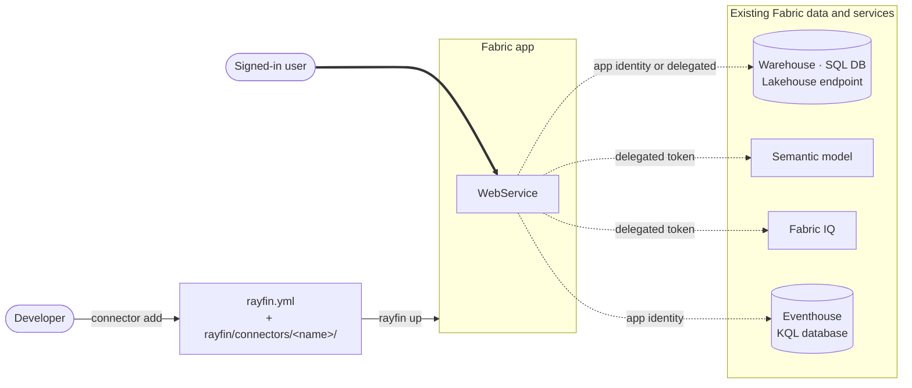

Connectors let a Rayfin app query data it does not own. Your [entities](/docs/data) live in
the database Rayfin provisions for you; a connector points at data that already exists
elsewhere in Microsoft Fabric — a Warehouse, a SQL Database, a Lakehouse SQL analytics
endpoint, a Power BI semantic model, or an Eventhouse KQL database — or at the Fabric IQ
service, and exposes it through the same client.

[Changed in 1.36](/docs/reference/changelog#rayfin-136)

Connectors are generally available since Rayfin 1.36. `rayfin connector` is always
registered, with no feature flag or opt-in.

`rayfin up connector apply` remains [Preview](/docs/reference/changelog#feature-status).

## What changed in 2.0

[Changed in 2.0](/docs/reference/changelog#rayfin-20)

- Register connectors with `connectorsService` in `RayfinClient.create`.
  `ConnectorsRayfinClient` is removed. See
  [Wiring connectors into your app](/docs/connectors/client-setup).
- The `kusto` type is renamed to `eventhouse`. It runs only queries saved in `rayfin.yml` and
  accepts only application auth, and new Eventhouse connectors still cannot be added. See
  [Eventhouse](/docs/connectors/eventhouse).
- The new `fabriciqmcp` connector answers natural-language questions about Power BI data.
  See [Fabric IQ](/docs/connectors/fabric-iq).
- `connector add --auth` sets the identity a connector runs as, `connector remove` keeps the
  `rayfin/connectors/<name>/` directory, and connector names are case-insensitive in every
  command and at runtime. See [Adding a connector](/docs/connectors/adding).
- Category A read results are typed to the fields you select. See
  [Fabric SQL sources](/docs/connectors/sql-sources).
- Category B calls wait up to 5 minutes and accept a per-call `timeoutMs`. See
  [Set a request timeout](/docs/connectors/client-setup#set-a-request-timeout-for-category-b-calls).

## The two categories

Which commands apply, and what your app code looks like, depends on the connector's
category.

| | Category A — entity connectors | Category B — function-bridge connectors |
| --- | --- | --- |
| **Types** | `fabric-sqlanalytics`, `fabric-warehouse`, `fabric-sqldatabase` | `fabric-semanticmodel`, `fabriciqmcp`; existing `eventhouse` entries |
| **App surface** | `client.connectors.<name>.<Entity>` — typed CRUD | `client.connectors.<name>.<operation>(input, options?)` |
| **You write** | Entity classes with `@role()` policies | A DAX query, a Fabric IQ conversation, or a saved KQL query |
| **Row-level security** | Yes, via `@role()` policies | No — the source enforces its own |
| **Schema discovery** | Yes — `metadata.json` | No |
| **Auth** | `application` by default; `delegated` allowed | `delegated` for `fabric-semanticmodel` and `fabriciqmcp`; `application` for `eventhouse` |

Category A turns Fabric SQL into typed entities that behave like your own — see
[Fabric SQL sources](/docs/connectors/sql-sources). Category B hands a request to a
platform-managed function and returns its result — see
[Semantic models](/docs/connectors/semantic-models), [Fabric IQ](/docs/connectors/fabric-iq),
and [Eventhouse](/docs/connectors/eventhouse).

## Connector types

| Type | Fabric item | Category | Operations | Auth |
| --- | --- | --- | --- | --- |
| `fabric-sqlanalytics` | Lakehouse SQL analytics endpoint | A | `read` | Default `application`; allows `delegated` [Changed in 1.36](/docs/reference/changelog#rayfin-136) |
| `fabric-warehouse` | Warehouse | A | `read`, `create`, `update`, `delete` | Default `application`; allows `delegated` [Changed in 1.36](/docs/reference/changelog#rayfin-136) |
| `fabric-sqldatabase` | SQL Database | A | `read`, `create`, `update`, `delete` | Default `application`; allows `delegated` [Changed in 1.36](/docs/reference/changelog#rayfin-136) |
| `fabric-semanticmodel` | Semantic model | B | `executeQuery` | `delegated` only |
| `fabriciqmcp` | None — the connector is itemless | B | `executeQuery` | `delegated` only [New in 2.0](/docs/reference/changelog#rayfin-20) |
| `eventhouse` | KQL Database | B | `executeQuery`, `executeCommand` | `application` only; existing connectors only [Changed in 2.0](/docs/reference/changelog#rayfin-20) [Experimental](/docs/reference/changelog#feature-status) |

Lakehouse SQL analytics endpoints are read-only at the source, so `fabric-sqlanalytics`
allows only `read`. Category B types are pinned to an adapter version (`version: "1"` today).
`rayfin up` rejects an `auth.type` that the connector type does not allow.

[Changed in 2.0](/docs/reference/changelog#rayfin-20)

Rayfin 2.0 renamed the `kusto` type to `eventhouse`, and `type: kusto` is rejected as an
unsupported type. New Eventhouse authoring is held: `connector types` and `connector search`
omit the type, and `connector add --type eventhouse` fails with:

```text
Connector type "eventhouse" is not available in this release. Supported types: [fabric-sqlanalytics, fabric-warehouse, fabric-sqldatabase, fabric-semanticmodel, fabriciqmcp].
```

Existing Eventhouse entries still validate, deploy, and answer calls. See
[Eventhouse](/docs/connectors/eventhouse) to migrate a 1.36 `kusto` connector.

## Read the live catalog

`npx rayfin connector types --json` prints the authoring catalog of the installed CLI: each
type's category, default and allowed auth, operations, required config, and the exact client
packages and version to install. Prefer it over a copied list.

## How a connector reaches your app



Nothing about the source reaches the browser. Workspace and item IDs — and Eventhouse saved
queries — live in `rayfin.yml` and are applied server-side, so a client-side call carries only
its query, its saved-query id and parameters, or its protocol message.

## Where connector state lives

| Path | Written by | Contents |
| --- | --- | --- |
| `rayfin/rayfin.yml` | `connector add`, then you | The `connectors:` block — `name`, `type`, `version`, `config`, `auth`, `operations`, and, for Eventhouse, `additionalPayload` |
| `rayfin/connectors/<name>/metadata.json` | `connector add` | Discovered schema. Category A only. Never edit by hand |
| `rayfin/connectors/<name>/schema.ts` | `connector add`, then you | The typed marker and `connectorConfig` your app imports |
| `src/lib/connectors.ts` | `connector add` and `connector remove` | The app's connector maps, when the app template includes the file |

`connector add` scaffolds a **placeholder** `schema.ts` for Category A. You replace it with
the aggregate schema after generating entity files — see
[Generating entity files](/docs/connectors/entity-generation). For `fabric-semanticmodel` and
`fabriciqmcp`, the generated `schema.ts` is complete and must not be edited.

[Changed in 2.0](/docs/reference/changelog#rayfin-20)

`connector remove` removes the `rayfin.yml` entry and the app wiring but keeps the whole
`rayfin/connectors/<name>/` directory, including entity files you wrote. Files left there can
still be compiled by `rayfin up`; back them up and delete them when you no longer need them.

## Connector names are case-insensitive

[Changed in 2.0](/docs/reference/changelog#rayfin-20)

The spelling in `rayfin.yml` is canonical: it names the `rayfin/connectors/<name>/`
directory, the keys in `src/lib/connectors.ts`, and the backend routes `rayfin up` deploys.
`connector add` stores new names in lowercase, so `--name SalesDW` declares `salesdw`.
Entries written by older CLI versions keep their spelling.

- `connector remove`, `connector invoke`, `connector inspect --name`, and
  `up connector apply --name` match the name you pass case-insensitively, then use the
  `rayfin.yml` spelling.
- `client.connectors.<name>` resolves the same way at runtime: an exact key wins, otherwise the
  one key that differs only by case. Typed access through `AppConnectorsSchema` still needs
  the exact key.
- `rayfin up` and `rayfin dev` reject two entries whose names differ only by case. Until you
  rename or remove one, CLI commands fail with the candidate names, and app code fails with
  `AMBIGUOUS_CONNECTOR`.

## The workflow

### 1. Find the source

`npx rayfin connector search` lists the Fabric items the signed-in identity can add, with a
ready-to-run `add` command for each. Fabric IQ is itemless, so search does not list it.

### 2. Add it

`npx rayfin connector add --type <type> --workspace-id <id> --item-id <id>` writes the
`rayfin.yml` entry and scaffolds the connector directory. For Fabric IQ, run
`npx rayfin connector add --type fabriciqmcp --name <name>`. See
[Adding a connector](/docs/connectors/adding).

### 3. Install the packages

`connector add` scaffolds files but installs nothing. Run the version-pinned `npm install`
it prints, verbatim.

### 4. Build the typed surface

Category A: generate entity files from `metadata.json` and write the aggregate `schema.ts`.
Category B: the generated `schema.ts` is already complete.

### 5. Wire the client

Register the connector with `connectorsService` under `services.connectors` in
`RayfinClient.create`, so it is reachable as `client.connectors.<name>` — see
[Wiring connectors into your app](/docs/connectors/client-setup).

### 6. Deploy

`npx rayfin up` deploys the connector alongside the rest of the app. `rayfin dev` does not
wire connectors, so test them against a deployment.

### 7. Prove data comes back

Run one real query before you build UI on the connector:

| Connector | How to prove it |
| --- | --- |
| Category A | `npx rayfin connector inspect --name <name> --entity <entity> --rows 1` |
| `fabric-semanticmodel` | `npx rayfin connector invoke <name> executeQuery --file <payload.json>`; this works before `rayfin up` |
| `fabriciqmcp` | Ask one question from the deployed app |
| `eventhouse` | Run every saved query from a test page in the deployed app |

A CLI probe proves source access, not the deployed path: the connector is proven once the
deployed app runs the query and renders real rows.

## In this section

- **[Adding a connector](/docs/connectors/adding)** — `search`, `add`, `list`, `remove`, and
  the `rayfin.yml` entry they produce.
- **[Wiring connectors into your app](/docs/connectors/client-setup)** — `connectorsService`,
  the runtime map, host selection, and the entity-class bundler setting.
- **[Fabric SQL sources](/docs/connectors/sql-sources)** — reading and writing Category A
  entities, and what each dialect returns.
- **[Generating entity files](/docs/connectors/entity-generation)** — turning
  `metadata.json` into entity classes with row-level policies.
- **[Semantic models](/docs/connectors/semantic-models)** — running DAX and reading the
  result.
- **[Fabric IQ](/docs/connectors/fabric-iq)** — natural-language questions over Power BI data.
- **[Eventhouse (KQL databases)](/docs/connectors/eventhouse)** — saved KQL queries, and
  migrating a 1.36 `kusto` connector.
- **[Connector authentication](/docs/connectors/auth)** — `delegated` versus `application`,
  and the permissions each needs.

```prompt title="Connect a Rayfin app to existing Fabric data"
In my Rayfin 2.0 project, connect to an existing Microsoft Fabric data source. Ask me which
one — a Warehouse, SQL Database, Lakehouse SQL analytics endpoint, or semantic model — and
ask me for its workspace ID and item ID rather than inventing them, or find them with
`npx rayfin connector search --all-workspaces --type <type> --json` and use the `addCommand`
from the result. If I ask for a KQL database (Eventhouse), stop and report that new
Eventhouse connector authoring is held in Rayfin 2.0.0.

Run `npx rayfin connector add --type <type> --workspace-id <id> --item-id <id>` and then the
version-pinned npm install command it prints, verbatim — do not drop the version.

If it is a Category A type (fabric-sqlanalytics, fabric-warehouse, fabric-sqldatabase),
generate entity files from rayfin/connectors/<name>/metadata.json and overwrite the
placeholder schema.ts with the aggregate schema. If it is fabric-semanticmodel, the generated
schema.ts is complete — do not edit it.

Wire it up as client.connectors.<name>: in the app's `RayfinClient.create` call, register
`connectors: connectorsService<AppConnectorsSchema>({ configs, runtime })` from
@microsoft/rayfin-connectors under `services`, using the maps in src/lib/connectors.ts when
the CLI generated that file. Deploy with `npx rayfin up`, then prove one real query returns
rows before building any UI.
```
