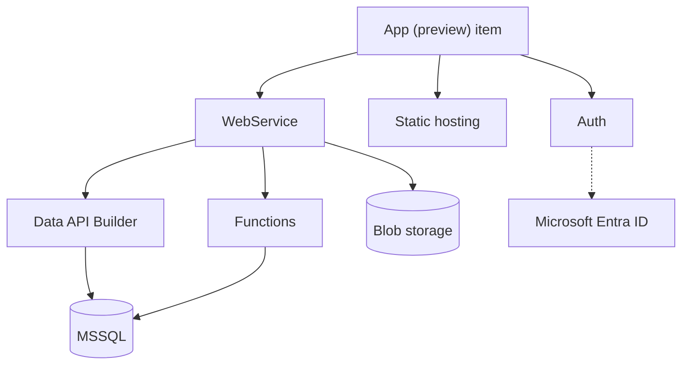

A **Fabric app** is the managed Microsoft Fabric item that hosts a Rayfin project. In the Fabric portal, create it with **New item** → **App (preview)**.

## What a Fabric app contains



| Service | `rayfin.yml` key | Status | What it provides |
| --- | --- | --- | --- |
| Auth | `services.auth` | GA | Session issuing and Microsoft Entra ID through Fabric SSO. |
| Data | `services.data` | GA | GraphQL over the app's Fabric MSSQL database. |
| Static hosting | `services.staticHosting` | GA | Built frontend assets served from the app origin. |
| Functions | `services.functions` | GA since 1.36 | TypeScript server workflows. [Changed in 1.36](/docs/reference/changelog#rayfin-136) |
| Storage | `services.storage` | Experimental | Blob storage when the storage feature is enabled. [Experimental](/docs/reference/changelog#feature-status) |

> [!NOTE]
> Functions are not available in every Fabric region or tenant.

> [!WARNING]
> Storage is experimental and not available in every Fabric region or tenant.

## Capacity readiness

A Fabric app lives inside a Fabric workspace, and the workspace needs usable Fabric capacity. Rayfin 1.36 checks capacity during first deploys and can create a new workspace, start or reuse an eligible Fabric trial capacity, or assign a selected capacity when the user consents. [New in 1.36](/docs/reference/changelog#rayfin-136)

Pass `--capacity-id <capacity-guid>` to choose a capacity explicitly. Existing recorded deployments keep their current workspace capacity.


## Prerequisites

### Tenant setting

A Fabric tenant administrator must enable **Fabric Apps (preview)** before users can create Rayfin-hosted apps:

1. Open the [Fabric admin portal](https://app.fabric.microsoft.com/admin-portal).
2. Go to **Tenant settings**.
3. Enable **Fabric Apps (preview)**.
4. Scope the setting to the whole organization or the security groups that should build apps.
5. Click **Apply**.

### Workspace capacity

The workspace that contains the App (preview) item must have usable Fabric capacity. If it does not, Rayfin 1.36 can prepare a workspace during first deploy, including trial-capacity readiness when the account and tenant are eligible. See [Deploying with rayfin up](/docs/deploy/rayfin-up#prepare-workspace-capacity).

## Create an App (preview) item in the portal

1. Open [Microsoft Fabric](https://app.fabric.microsoft.com).
2. Select or create a workspace with Fabric capacity.
3. Click **New item**.
4. Search for **App (preview)** and create it.
5. Open the item in VS Code, or deploy an existing local project with `npx rayfin up`.

The CLI can also create the item during first deploy. The Fabric item display name defaults to `id` in `rayfin.yml`; use `--item-name` to override it for the deploy. [New in 1.36](/docs/reference/changelog#rayfin-136)


## Child services

Rayfin provisions child services based on `rayfin.yml`. The portal can show these resources, but schema and settings are code-owned and should be changed through Rayfin commands.

| Child service | What it provides | How to update it |
| --- | --- | --- |
| SQL Database | Tables and indexes generated from decorated entities. | Change entity code and run `npx rayfin up` or `npx rayfin up db apply`. |
| Authentication | Fabric brokered auth backed by Microsoft Entra ID. | Update `services.auth` in `rayfin.yml` and redeploy. |
| Static content | Built HTML, CSS, JavaScript, and assets. | Run `npx rayfin up` or `npx rayfin up staticapp deploy`. |
| Functions | Server-side TypeScript functions when enabled. | Run `npx rayfin up` or `npx rayfin up functions deploy`. |

## Rayfin endpoint and app URL

Each Fabric app has a Rayfin backend endpoint used by the SDK and, when static hosting is enabled, a hosting URL used by browsers. `rayfin up status --json` reports the recorded hosting URL as `deployment.hostingUrl`.

| Route | Used for |
| --- | --- |
| `/api` | Backend API routes, including auth helpers. |
| `/graphql` | Data API queries and mutations. |
| `/functions/<name>/invoke` | Function invocation through the deployed backend. |
| `/connectors` and `/connector-invoke` | Connector metadata and invocation. |

## Permissions

| Permission | What it allows |
| --- | --- |
| Workspace Viewer plus item Run and interact | Open and use the deployed app. |
| Workspace Contributor or Admin | Deploy with `rayfin up`, apply schema changes, and update settings. |
| Workspace Admin | Assign workspace capacity and reshare access. |

```prompt title="Create or target a Fabric app"
Help me deploy this Rayfin project into Microsoft Fabric. If rayfin/.deployments.json has a recorded deployment, reuse it. Otherwise, target the Fabric workspace I provide or help me choose one, ensure the workspace has usable capacity, and run `npx rayfin up`. Use the portal item name App (preview) when describing manual steps.
```

## Next steps

- [Deploying with rayfin up](/docs/deploy/rayfin-up)
- [Capacity and billing](/docs/deploy/pricing)
- [Static hosting](/docs/hosting)
