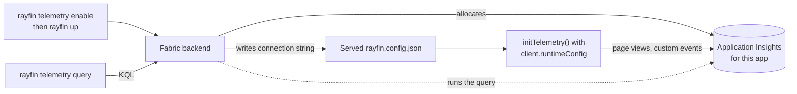

[New in 2.0](/docs/reference/changelog#rayfin-20) [Experimental](/docs/reference/changelog#feature-status)

Use Observability to see what a deployed Fabric app does in users' browsers — the pages they view and the events your code emits — and to query that telemetry from the CLI while you investigate a problem. Rayfin allocates one Application Insights resource per deployed app, gives the app its connection string at runtime, and runs your KQL queries against that resource.

> [!WARNING]
> Observability is experimental. The `rayfin telemetry` commands need no feature flag, but allocating the Application Insights resource and querying it both require Fabric service-side telemetry enablement for the target workspace; no local setting turns it on. Querying also needs Write permission on the app item. The browser distribution it builds on, `@microsoft/opentelemetry-browser`, is a beta release.
>
> Disabling telemetry and then running `rayfin up` deletes the app's Application Insights resource and all telemetry collected in it. Re-enabling creates a new, empty resource.

## How it works



| Source | What reaches the app's Application Insights resource | What you set up |
| --- | --- | --- |
| Browser frontend | Page views, plus the custom events you emit as named OpenTelemetry log records. No automatic Fetch/XHR, console, or error collection. | Install and initialize `@microsoft/rayfin-telemetry/browser`, then emit events. |
| Deployed Functions | `rayfin up` points the functions' telemetry destination at the app's resource when Functions and telemetry are both enabled. | Enable both services and deploy. |
| Fabric platform | Nothing. Fabric's internal monitoring stays separate. | — |
| Rayfin CLI usage | Nothing. [CLI usage telemetry](/docs/reference/cli/telemetry#rayfin-cli-usage-telemetry) is a separate product channel. | `RAYFIN_TELEMETRY_OPTOUT=1` opts out of CLI usage telemetry only. |

## Prerequisites

- A Rayfin 2.0 project you deploy with `rayfin up` to an approved Fabric workspace.
- Fabric service-side telemetry enablement for that workspace. Ask your Fabric environment operator; it cannot be enabled from the project.
- Server-written runtime configuration for static deployments, a separate service-side setting, so the served `rayfin.config.json` carries the connection string.
- Write permission on the app item, to run queries.
- A frontend built with a bundler, such as the Vite setup in the Rayfin templates, running in a current version of Chrome, Edge, Firefox, Opera, or Safari.

## Enable telemetry

From inside the project:

```bash
npx rayfin telemetry enable
```

The command sets one key in `rayfin.yml` and prints `✅ Telemetry enabled.`:

```yaml title="rayfin/rayfin.yml"
services:
  telemetry:
    enabled: true
```

It changes local configuration only; nothing is allocated until you deploy. If telemetry is already enabled, it prints `Telemetry is already enabled. No change was made.` Do not put a connection string, resource ID, or credential in this block — Rayfin allocates and stores them for you.

## Deploy

Preview the target, then deploy:

```bash
npx rayfin login
npx rayfin up --dry-run
npx rayfin up
```

With telemetry enabled, deployment:

1. Sends the setting to the Fabric backend, which checks the service-side enablement and allocates an Application Insights resource for the app, or reuses the one it already allocated.
2. Stores the resource and its connection string with the app.
3. Installs the query adapter that `rayfin telemetry query` uses. A query never installs a missing adapter.
4. Points the app's deployed Functions at the same resource, when Functions are enabled.
5. Writes the connection string into the hosted `rayfin.config.json` as `applicationInsightsConnectionString`.

A successful deployment does not prove the browser received the connection string: the `rayfin.config.json` the CLI builds locally does not contain it. Check the served file.

## Check the connection string

Sign in to the deployed app, open the browser developer console on the app's own document — not the outer Fabric portal frame — and run:

```javascript
const response = await fetch('/rayfin.config.json', { cache: 'no-store' });
if (!response.ok) throw new Error(`Runtime configuration request failed: HTTP ${response.status}`);
const config = await response.json();
console.log({
  hasConnectionString: Boolean(config.applicationInsightsConnectionString),
  workspaceId: config.workspaceId,
  itemId: config.itemId,
});
```

`applicationInsightsConnectionString` is present only when telemetry is enabled and a resource has been allocated. Confirm that `workspaceId` and `itemId` identify the app you deployed. If your app serves its runtime configuration from a custom base path, fetch the URL its client uses.

In app code, read the same value from the client:

```typescript
const connectionString = rayfinClient.runtimeConfig?.applicationInsightsConnectionString;
```

The client has it only when you create it with the `runtimeConfig` returned by `resolveRayfinConfig()`. Under `npm run dev` there is no served `rayfin.config.json`, so the value is absent and browser telemetry stays off. Test telemetry against the deployed app. Do not copy a deployed connection string into local configuration or into a bundle you promote to another stage.

The connection string identifies where telemetry goes. It grants no read access, so it can ship to the browser — but anyone can copy it and send data to it, so sample, review ingestion volume, and never treat a client event as proof of a business transaction.

## Install the browser SDK

Install `@microsoft/rayfin-telemetry` at your Rayfin version, with its pinned peer dependencies at exactly these versions:

```bash
npm install @microsoft/rayfin-telemetry@2.0.0 @microsoft/opentelemetry-browser@0.1.0-beta.2 @opentelemetry/api@1.9.1 @opentelemetry/api-logs@0.222.0 @opentelemetry/resources@2.11.0
```

In a Universal App project, run it from the project root with `-w @rayfin-app/frontend`. `@microsoft/rayfin-client` is a peer dependency too; your app already has it. See the [`@microsoft/rayfin-telemetry` reference](/docs/reference/sdk/rayfin-telemetry) for the full API.

## Initialize browser telemetry

Create the client from resolved runtime configuration, so `rayfinClient.runtimeConfig` carries the connection string:

```typescript title="src/services/rayfinClient.ts"
import { RayfinClient, resolveRayfinConfig } from '@microsoft/rayfin-client';
import { browserSession } from '@microsoft/rayfin-auth';
import { dataService } from '@microsoft/rayfin-data';
import type { AppSchema } from '../../rayfin/data/schema';

const resolved = await resolveRayfinConfig({
  apiUrl: import.meta.env.VITE_RAYFIN_API_URL,
  publishableKey: import.meta.env.VITE_RAYFIN_PUBLISHABLE_KEY,
});

export const rayfinClient = RayfinClient.create({
  baseUrl: resolved.baseUrl!,
  publishableKey: resolved.publishableKey!,
  runtimeConfig: resolved.runtimeConfig,
  auth: browserSession({ storage: true }),
  services: { data: dataService<AppSchema>() },
});

export type AppClient = typeof rayfinClient;
```

Wrap `initTelemetry()` in one module, with a smoke-test helper for verification:

```typescript title="src/telemetry.ts"
import { initTelemetry } from '@microsoft/rayfin-telemetry/browser';
import { logs } from '@opentelemetry/api-logs';

import { rayfinClient } from './services/rayfinClient';

const SERVICE_NAME = 'contoso-orders-frontend';

let telemetry: Awaited<ReturnType<typeof initTelemetry>>;

/** Start browser telemetry once per page, after any consent your app requires. */
export async function startTelemetry(): Promise<void> {
  telemetry = await initTelemetry({
    runtimeConfig: rayfinClient.runtimeConfig,
    serviceName: SERVICE_NAME,
  });
}

/** Emit one synthetic event to verify ingestion. Never call it on every render. */
export async function sendSmokeTest(): Promise<void> {
  if (!telemetry) return;
  const { workspaceId, itemId } = rayfinClient.runtimeConfig ?? {};
  logs.getLogger(SERVICE_NAME).emit({
    eventName: 'observability.smoke_test',
    attributes: {
      'test.synthetic': true,
      ...(workspaceId ? { 'fabric.workspace.id': workspaceId } : {}),
      ...(itemId ? { 'fabric.item.id': itemId } : {}),
    },
  });
  await telemetry.forceFlush();
}
```

Start it from the browser entry point, outside React render and effects, before code that emits telemetry runs:

```tsx title="src/main.tsx"
import { StrictMode } from 'react';
import { createRoot } from 'react-dom/client';

import App from './App';
import { startTelemetry } from './telemetry';

try {
  await startTelemetry();
} catch (error) {
  console.error('Browser telemetry did not start.', error);
}

createRoot(document.getElementById('root')!).render(
  <StrictMode>
    <App />
  </StrictMode>,
);
```

If your app needs consent before it collects telemetry, call `startTelemetry()` after consent instead. In a Universal App, the client already resolves runtime configuration: pass `(await getRayfinClient()).runtimeConfig` from `packages/frontend/src/lib/rayfin-client.ts` instead of creating another client.

`initTelemetry()` behaves this way:

- Without a connection string, it logs `Observability is not configured for this deployment; browser telemetry is off.` and resolves `undefined`.
- It creates one instance per page. Later calls, including from React Strict Mode or hot reload, reuse it and ignore new options; a call with a different connection string, workspace, or item rejects until the page reloads.
- If the SDK fails to initialize, the promise rejects, and a later call can retry.
- It collects page views and keeps sessions and SDK-managed user context, with 100% sampling. It adds no Fetch/XHR, console, or error instrumentation.

## Verify with a test event

Call `sendSmokeTest()` once in the deployed app — for example, from a temporary button — then check each stage:

1. **Transport.** In the browser network panel, look for a `POST` to the ingestion endpoint ending in `/v2/track`, and check its status and response. A finished `forceFlush()` is not proof of ingestion.
2. **Ingestion.** Allow for ingestion delay, then query the event:

   ```bash
   npx rayfin telemetry query "customEvents | where name == 'observability.smoke_test' | project timestamp, name, customDimensions | order by timestamp desc | take 20" --timespan PT1H --max-rows 20 --json
   ```

3. **Association.** Check that `customDimensions` contains the `fabric.workspace.id` and `fabric.item.id` of the app you deployed.

The named log record arrives in `customEvents`; page views arrive in `pageViews`. An empty successful result means no matching rows yet — not proof that emission or ingestion worked or failed.

## Query telemetry

```bash
npx rayfin telemetry query "pageViews | project timestamp, name, duration | order by timestamp desc | take 20" --timespan PT1H
```

Pass the whole KQL query as one quoted argument. Rayfin queries the Application Insights resource allocated to the active deployment — not its backing Log Analytics workspace — so use Application Insights table and column names: `traces`, `customEvents`, `pageViews`, `exceptions`, `requests`, and `dependencies`, with columns such as `timestamp`, `name`, `message`, `customDimensions`, and `duration`. You cannot point the command at another resource.

| Option | Description |
| --- | --- |
| `--timespan <duration>` | ISO 8601 duration limiting the query window, such as `PT1H`. |
| `--max-rows <count>` | Maximum rows to return, from 1 to 10,000. |
| `--json` | Return one JSON object with `status`, `count`, and `rows`. |
| `--output <mode>` | `interactive`, `plain`, or `json`. |

Without JSON output, each row prints as one JSON object per line. A row limit does not cap query cost; keep a time filter in every query. See [`rayfin telemetry`](/docs/reference/cli/telemetry#rayfin-telemetry-query) for error codes.

## Investigate an issue

Before reading results, know what the app collects. With the defaults above:

| Question | Table | Collected by default? |
| --- | --- | --- |
| Which pages were visited? | `pageViews` | Yes, after `initTelemetry()` runs. |
| Did a business event happen? | `customEvents` | Only events your code emits. |
| Were there error-level logs? | `traces` | Only logs your code emits. |
| Did browser exceptions occur? | `exceptions` | No. |
| Did outgoing HTTP calls fail? | `dependencies` | No. |
| Did server requests fail? | `requests` | Not from the browser SDK. |

Pick a narrow UTC window around the symptom, discover columns and event names before you filter on them, then run bounded queries:

```kusto
customEvents
| where timestamp >= ago(1h)
| summarize observedRecords = count() by name
| top 20 by observedRecords desc
```

```kusto
traces
| where timestamp >= ago(1h) and severityLevel >= 3
| project timestamp, severityLevel, message, operation_Id, session_Id
| order by timestamp desc
| take 50
```

Severity levels 3 and 4 are Error and Critical. To follow one operation, copy a non-empty `operation_Id` from a result:

```kusto
union withsource=signal pageViews, customEvents, traces
| where timestamp >= ago(1h)
| where operation_Id == '<observed-operation-id>'
| project timestamp, signal, name, message, operation_Id, session_Id
| order by timestamp asc
| take 100
```

Use `<table> | getschema` to list a table's columns. An empty result means no matching collected records, not that the app is healthy; report what the current collection cannot show. Do not enable extra instrumentation or redeploy only to make an investigation pass — review volume and privacy first.

## Functions telemetry

When Functions and telemetry are both enabled, `rayfin up` reconciles the deployed functions' telemetry destination with the app's Application Insights resource. Browser initialization does not configure function logging, and the setting alone does not establish which signals the functions emit — query `requests` or `traces` to confirm before you rely on them. When you disable telemetry, the functions' default telemetry configuration is restored before the resource is deleted.

## Disable telemetry

> [!WARNING]
> The next `rayfin up` after disabling deletes the app's Application Insights resource. Telemetry collected in it is no longer available, and re-enabling creates a new, empty resource.

```bash
npx rayfin telemetry disable
npx rayfin up --dry-run
npx rayfin up
```

`disable` sets `services.telemetry.enabled: false` and warns about the deletion; if telemetry is already off or not configured, nothing changes. After the deployment, the served `rayfin.config.json` no longer contains a connection string. Pages that are already open keep their SDK and connection string until they reload or call `shutdown()` on the handle, so also remove or gate the `initTelemetry()` call.

## Before production

- **Consent.** Initialize only in the browser, after any consent your app requires.
- **Sampling.** Pick a `samplingPercentage` between 0 and 100 for your volume budget; the 100% default is for validation. Page views and events consume ingestion volume. Confirm the ingestion quota, retention, and cost of the managed resource for your environment; these docs do not state them.
- **Privacy.** Use fixed event names and reviewed attributes. Never emit tokens, user content, emails, or request bodies. This SDK version also tries to send its own statistics to `https://data.stats.monitor.azure.com/v2/track`, separately from your app's resource.
- **Network.** Allow the ingestion host in your Content Security Policy `connect-src`.
- **Browser storage.** The SDK buffers unsent telemetry in `sessionStorage`; pass `storage: { enabled: false }` to `initTelemetry()` if that is not approved.

## Troubleshooting

| Symptom | Fix |
| --- | --- |
| `telemetry` is not a known command | Upgrade every Rayfin package, including the CLI, to 2.0.0. The commands need no feature flag. |
| `enable` succeeded but the served `rayfin.config.json` has no connection string | Deploy with `rayfin up`; `enable` only edits `rayfin.yml`. If it is still missing, ask your Fabric environment operator to confirm telemetry enablement and server-written runtime configuration for the workspace. |
| `initTelemetry()` warns that Observability is not configured | The client has no connection string. Create it with `runtimeConfig` from `resolveRayfinConfig()`, and test the deployed app rather than `npm run dev`. |
| `initTelemetry()` warns that new options are ignored | Only the first initialization on a page counts. Reload the page to change options. |
| `initTelemetry()` rejects for another destination, or after shutdown | Reload the page. Do not start a second SDK instance. |
| No `/v2/track` request appears | Check that `startTelemetry()` ran before the event, the handle is not shut down, and sampling is not 0. |
| Requests go to `/v1/traces` or `/v1/logs` | An OTLP exporter is pointed at Application Insights. Use the built-in Azure Monitor exporter through `initTelemetry()`. |
| Ingestion returns 400 | Use the full allocated connection string, not a workspace ID, resource ID, publishable key, or bare instrumentation key. |
| Ingestion returns 401 or 403, or the browser blocks the request | Check the resource's ingestion policy, your CSP `connect-src`, and network restrictions. Never publish a privileged credential to work around them. |
| `DEPLOYMENT_NOT_CONFIGURED` | Deploy with `rayfin up`, or switch to the intended deployment. |
| `AUTHENTICATION_REQUIRED` | Run `npx rayfin login` and retry. |
| `TELEMETRY_QUERY_FAILED` with `FEATURE_NOT_ENABLED` | Service-side telemetry is off for the workspace. Ask your Fabric environment operator. |
| `TELEMETRY_QUERY_FAILED` with `TELEMETRY_NOT_ENABLED` | Enable telemetry and deploy before querying. |
| `TELEMETRY_QUERY_FAILED` with `TELEMETRY_QUERY_UNAVAILABLE` | The resource or query adapter is missing. Redeploy with `rayfin up` and check for provisioning failures. |
| Permission denied when querying | Confirm you have Write permission on the app item. |
| A query succeeds with no rows | Check the time window, table and column names, the exact event name, sampling, and ingestion delay. |

When you ask for help, include the CLI and package versions, the workspace and item IDs, the UTC time window, and the error code and request ID from the CLI. Leave out credentials and customer data.

## Observability and CLI usage telemetry

Observability is your app's telemetry, sent to your app's resource. The Rayfin CLI separately reports anonymous usage data about its own commands; `RAYFIN_TELEMETRY_OPTOUT=1` turns that off and has no effect on Observability. See [Telemetry](/docs/reference/cli/telemetry).

```prompt title="Enable Observability and instrument the frontend"
In my Rayfin 2.0 project, set up Observability for the deployed Fabric app.

1. Run `npx rayfin telemetry enable` and confirm rayfin/rayfin.yml has services.telemetry.enabled: true. Never put a connection string or resource ID in rayfin.yml.
2. Show me the output of `npx rayfin up --dry-run`, and run `npx rayfin up` only after I approve the target workspace.
3. In the frontend package, install @microsoft/rayfin-telemetry@2.0.0 and its exact peer versions: @microsoft/opentelemetry-browser@0.1.0-beta.2, @opentelemetry/api@1.9.1, @opentelemetry/api-logs@0.222.0, and @opentelemetry/resources@2.11.0.
4. Make sure the existing Rayfin client is created with RayfinClient.create and the runtimeConfig returned by resolveRayfinConfig(). Reuse that client; do not create a second one.
5. Add a browser-only startup call to initTelemetry({ runtimeConfig: client.runtimeConfig, serviceName: '<app-name>-frontend' }) from @microsoft/rayfin-telemetry/browser, outside React render and effects and after any consent the app requires. Keep the defaults: no Fetch/XHR, console, or error instrumentation.
6. Add a temporary validation path that emits one 'observability.smoke_test' log record with logs.getLogger(...).emit from @opentelemetry/api-logs and then awaits forceFlush() on the handle.
7. After I trigger it in the deployed app, run `npx rayfin telemetry query "customEvents | where name == 'observability.smoke_test' | project timestamp, name, customDimensions | order by timestamp desc | take 20" --timespan PT1H --max-rows 20 --json` and report the result.
Never run `npx rayfin telemetry disable`: deploying after it deletes the Application Insights resource and its history.
```

```prompt title="Investigate an issue with Rayfin telemetry"
Investigate this problem in my deployed Rayfin app using its Application Insights telemetry: <describe the symptom and when it happened, in UTC>.

Use only `npx rayfin telemetry query "<KQL>" --timespan <ISO 8601 duration> --max-rows 100 --json`, passing each query as one quoted argument. Use Application Insights tables (pageViews, customEvents, traces, exceptions, requests, dependencies), not Log Analytics workspace tables.
1. Confirm the active deployment with `npx rayfin up status`, and choose a narrow UTC window around the symptom.
2. Find out what the app collects: read its initTelemetry call and any code that emits log records or events. By default only page views and explicitly emitted events are collected — no exceptions, console logs, Fetch/XHR dependencies, or incoming requests.
3. Discover columns with `<table> | getschema` and event names or customDimensions keys before filtering on them. Never assume a name or key exists.
4. Run bounded queries (a timestamp filter and take) for the relevant tables, and correlate rows only by a non-empty operation_Id or session_Id copied from results.
5. Report the window, the queries, the observed counts, and the findings the rows support, separately from hypotheses and from what current collection cannot show. An empty result is not proof the app is healthy.
Do not add instrumentation, change the telemetry destination, redeploy, or run `rayfin telemetry disable` without asking me.
```
