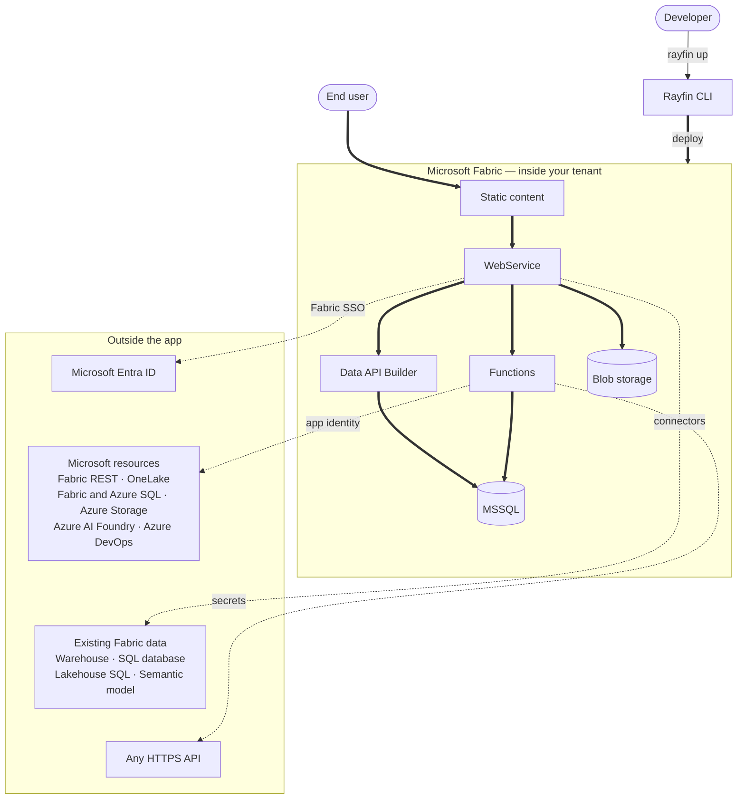

Rayfin is a backend platform for TypeScript developers. You define your data model as
decorated TypeScript classes, and Rayfin generates the database schema, REST and GraphQL
APIs, and type-safe clients — then runs them on Microsoft Fabric with authentication,
functions, blob storage, and static hosting built in.

```typescript title="rayfin/data/Todo.ts"
import { entity, uuid, text, boolean, authenticated } from '@microsoft/rayfin-core';

@entity()
@authenticated('*', { policy: (claims, item) => claims.sub.eq(item.user_id) })
export class Todo {
  @uuid() id!: string;
  @text({ max: 200 }) title!: string;
  @boolean({ default: false }) isCompleted!: boolean;
  @text({ max: 128 }) user_id!: string;
}
```

That class becomes a table, a GraphQL API, a typed client, and a row-level security
policy. One command deploys all of it.

```bash
npx rayfin up
```

> [!NOTE]
> Rayfin supports TypeScript as the only language for data models, client code, and
> application logic.

These docs cover Rayfin **1.36.2**. Every `@microsoft/rayfin-*` package — SDK, connectors,
and CLI — shares that version number. See the [Changelog](/docs/reference/changelog) for
what changed in 1.36 and how to upgrade.

## Get started

If you read one page, read the [Quickstart](/docs/start/quickstart) — it goes from an empty
terminal to a running app in a few commands.

- **[Installation](/docs/start/installation)** — install Node.js 22 or later on Windows,
  macOS, or Linux.
- **[Quickstart](/docs/start/quickstart)** — scaffold a project, sign in, and start the
  development session with `npm run dev`.
- **[Develop locally](/docs/start/develop-locally)** — what `rayfin dev` does: it keeps the
  backend in Fabric and runs your frontend and Functions on your machine.
- **[Project structure](/docs/start/project-structure)** — the `rayfin/` folder,
  `rayfin.yml`, and how entity classes become a database schema.
- **[Deploy to Fabric](/docs/start/deploy-to-fabric)** — enable the tenant setting, create
  a Fabric app, and publish with `rayfin up`.

## How a Fabric app runs

Rayfin runs one way: as a managed **Fabric app** on Microsoft Fabric.



`rayfin up` packages your project and provisions it as a Fabric app: Fabric hosts the
MSSQL database, a WebService and Data API Builder layer in front of it, your built frontend
as static content, and sign-in through Microsoft Entra ID.

[Functions](/docs/functions) are server-side TypeScript you enable in `rayfin.yml`. They
are also how the app reaches anything outside itself:

- They call any HTTPS API with secrets you store with `rayfin secret set` and read as
  `ctx.Secrets` — see [Secrets in functions](/docs/functions/secrets).
- They reach Microsoft resources — Fabric REST APIs, OneLake, Fabric and Azure SQL
  databases, Azure Storage, Azure AI Foundry, and Azure DevOps — through
  [connections](/docs/functions/connections) that run as the **app's identity** (for
  current Fabric apps, the owner of the Fabric app item). You grant that identity access to
  each resource.
- Reads and writes to your own Rayfin data from a function still run as the signed-in
  caller, so your entity permissions keep applying.

[Connectors](/docs/connectors) cover the other direction: data that already lives in Fabric.
Point one at a Warehouse, SQL database, Lakehouse SQL analytics endpoint, or semantic model
and query it from the same client — as typed entities, or with DAX. `rayfin connector add`
configures SQL connectors to run as the app identity, and you can switch one to the
signed-in user; semantic models always run as the signed-in user. See
[Delegated access](/docs/auth/delegated-access) for which identity each surface uses.

> [!NOTE]
> Functions and connectors are generally available as of Rayfin 1.36, but Functions are
> not available in every Fabric region or tenant. [Blob storage](/docs/storage) is
> experimental. Confirm availability in your tenant before you depend on them.

During development, `npm run dev` runs `rayfin dev`: it provisions or reuses this same
backend in Fabric, applies your schema, and serves the frontend — plus any Functions — from
your machine, in place of the *Static content* node above. There is no backend to run
yourself. See [Develop locally](/docs/start/develop-locally).

## Build your app

- **[Data](/docs/data)** — model entities, query and aggregate them, and control who can
  read each row.
- **[Auth](/docs/auth)** — sign users in with Fabric SSO, sign in with an Entra token you
  already hold, or embed the app in your own portal.
- **[Functions](/docs/functions)** — server-side TypeScript for logic that does not belong
  in the client, and for calling external services.
- **[Connectors](/docs/connectors)** — read and write data that already exists in Fabric:
  warehouses, SQL databases, Lakehouse SQL endpoints, and semantic models.
- **[Storage](/docs/storage)** — upload, serve, and secure files in blob storage.
  Experimental.
- **[Hosting](/docs/hosting)** — build and serve your frontend from the deployed app,
  control who can load it, and make views shareable with deep links.
- **[Deploy](/docs/deploy)** — capacity, secrets, environments, deployment pipelines, and
  troubleshooting.

## Using an agent

These docs are built for coding agents as much as for people. Every page has a raw
Markdown mirror — append `.md` to any URL — and the whole corpus is available at
[`/llms-full.txt`](/llms-full.txt).

```prompt title="Point your agent at Rayfin"
Read https://rayfin.ai/llms.txt and then https://rayfin.ai/docs/reference/agent-rules.md so you know how
to work with the Rayfin SDK and CLI. Every page on that site is available as raw Markdown by
appending .md to its URL. Check the version of the @microsoft/rayfin-* packages in my
package.json first: features tagged "New in 1.36" on that site are not available in older
versions. Then help me build a Rayfin app.
```

See [Rules for coding agents](/docs/reference/agent-rules) for the constraints an agent
needs before it writes Rayfin code.

> [!TIP]
> Prefer a desktop app to a terminal? [Fabricator](https://spatney.github.io/rayfin-fabricator/)
> is a Copilot harness that helps you build Rayfin apps. Describe the app you want, watch
> GitHub Copilot build it, preview it running, and deploy it to Microsoft Fabric — all in
> one window, with your own GitHub Copilot account. Fabricator is a free, open-source
> community project. It is not a Microsoft product and is not supported by Microsoft.

## Reference

- [Changelog](/docs/reference/changelog) — what changed in each release, and how to
  upgrade.
- [CLI](/docs/reference/cli) — every command and flag.
- [`rayfin.yml`](/docs/reference/config/rayfin-yml) — the configuration schema.
- [SDK](/docs/reference/sdk) — API reference for every `@microsoft/rayfin-*` package.
- [Known limitations](/docs/reference/known-limitations) — current constraints and workarounds.
