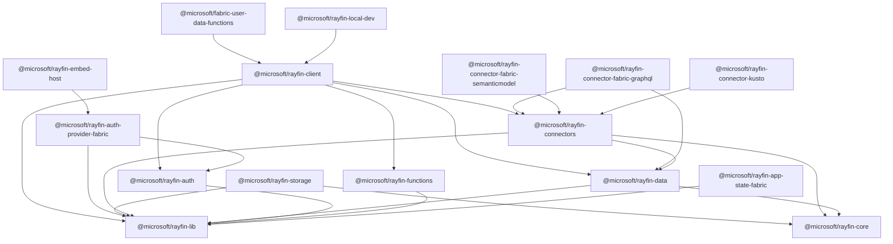

Rayfin packages are split by capability.
Most applications install only a few packages directly; the rest arrive as transitive dependencies.

Keep every `@microsoft/rayfin-*` package on the same exact version.
Rayfin 1.36 promotes `@microsoft/fabric-user-data-functions` in the catalog for Functions authoring; use the matching Rayfin release version for that package too.

[Changed in 1.36](/docs/reference/changelog#rayfin-136)

## Install packages at one version

All `@microsoft/rayfin-*` packages ship in lockstep.
Do not mix `@microsoft/rayfin-client@1.36.2` with `@microsoft/rayfin-core@1.35.1`, or a CLI from a different Rayfin release.

Packages in the Rayfin catalog that do not use the `@microsoft/rayfin-*` name, such as `@microsoft/fabric-user-data-functions`, are also published at the Rayfin release version.

```bash
npm install @microsoft/rayfin-core@1.36.2 @microsoft/rayfin-client@1.36.2
```

Add capability packages at the same exact version:

```bash
npm install @microsoft/rayfin-storage@1.36.2
npm install @microsoft/fabric-user-data-functions@1.36.2
```

## Which package do I need?

| I want to... | Package |
| --- | --- |
| Define entities, fields, relationships, permissions, validation, and experimental storage folders | [`@microsoft/rayfin-core`](/docs/reference/sdk/rayfin-core) |
| Query and mutate data with the typed GraphQL client | [`@microsoft/rayfin-data`](/docs/reference/sdk/rayfin-data) |
| Use one configured client for data, auth, functions, and connectors | [`@microsoft/rayfin-client`](/docs/reference/sdk/rayfin-client) |
| Sign users out, inspect sessions, and manage auth state | [`@microsoft/rayfin-auth`](/docs/reference/sdk/rayfin-auth) |
| Add Microsoft Fabric SSO and direct Entra-token sign-in | [`@microsoft/rayfin-auth-provider-fabric`](/docs/reference/sdk/rayfin-auth-provider-fabric) |
| Call Rayfin Functions | [`@microsoft/rayfin-functions`](/docs/reference/sdk/rayfin-functions) |
| Author Rayfin Functions with `udf.func()`, `RayfinContext`, `AudienceType`, and generated types | `@microsoft/fabric-user-data-functions` — documented under [Functions](/docs/functions); no SDK reference page. [Changed in 1.36](/docs/reference/changelog#rayfin-136) |
| Route local Functions calls from Vite while `rayfin dev` is running | `@microsoft/rayfin-local-dev` — see [Develop locally](/docs/start/develop-locally). |
| Store and serve files with experimental Storage | [`@microsoft/rayfin-storage`](/docs/reference/sdk/rayfin-storage) [Experimental](/docs/reference/changelog#feature-status) |
| Query Fabric SQL analytics endpoints, warehouses, SQL databases, and semantic models through connectors | [`@microsoft/rayfin-connectors`](/docs/reference/sdk/rayfin-connectors) |
| Type a Fabric SQL-backed connector entity | [`@microsoft/rayfin-connector-fabric-graphql`](/docs/reference/sdk/rayfin-connector-fabric-graphql) |
| Type and run a Fabric semantic model connector | [`@microsoft/rayfin-connector-fabric-semanticmodel`](/docs/reference/sdk/rayfin-connector-fabric-semanticmodel) |
| Maintain an existing Kusto connector | [`@microsoft/rayfin-connector-kusto`](/docs/reference/sdk/rayfin-connector-kusto) |
| Embed a Rayfin app outside the Fabric portal | [`@microsoft/rayfin-embed-host`](/docs/reference/sdk/rayfin-embed-host) [New in 1.36](/docs/reference/changelog#rayfin-136) |
| Persist app state in Fabric | [`@microsoft/rayfin-app-state-fabric`](/docs/reference/sdk/rayfin-app-state-fabric) |
| Read lower-level HTTP, error, and utility types | [`@microsoft/rayfin-lib`](/docs/reference/sdk/rayfin-lib) |

## How the packages compose



`@microsoft/rayfin-core` is mostly build-time.
Your `rayfin/data/` and `rayfin/storage/` classes import it so the CLI can generate backend configuration.

The client packages run in the browser, Functions runtime, Node.js scripts, or connector runtime.
`@microsoft/fabric-user-data-functions` is the function-authoring surface documented in the Functions section.
`@microsoft/rayfin-local-dev` provides development adapters such as Vite routing for local Functions calls under `rayfin dev`.

## Experimental subpath exports

Use stable package roots for new code unless a page explicitly says otherwise.

| Package | Subpath | What remains there |
| --- | --- | --- |
| `@microsoft/rayfin-core` | `/experimental` | Storage-only exports: `blob`, `StorageObject`, `bytes`, `kb`, `mb`, `gb`, `ContentTypes`, and storage option types. Connector symbols were removed from this subpath in 1.36. |
| `@microsoft/rayfin-client` | `/experimental` | `ExtendableRayfinClient` and service plugin helper types; `ConnectorsRayfinClient` is still re-exported here for compatibility but is also exported from the stable root in 1.36. |

## Version notes

- Keep the CLI, SDK packages, connector packages, and catalog packages on one Rayfin release version.
- Install lower-level packages directly only when your code imports them. For example, `@microsoft/rayfin-data`, `@microsoft/rayfin-auth`, and `@microsoft/rayfin-lib` are dependencies of `@microsoft/rayfin-client`.
- Storage is experimental and remains behind the storage feature gate or `services.storage.enabled: true`.
- Connectors are generally available in 1.36, but `rayfin up connector apply` is still preview and Kusto authoring is held back for new connectors.
- When you need the exact signature for the version installed in a project, use `rayfin docs get` or `rayfin docs search` from that project root instead of relying on a cached API shape.

## In this section

- [`@microsoft/rayfin-core`](/docs/reference/sdk/rayfin-core) — decorators for entities, fields, relationships, permissions, validation, and experimental storage folder declarations.
- [`@microsoft/rayfin-data`](/docs/reference/sdk/rayfin-data) — the fluent query, aggregation, and mutation API behind `client.data`.
- [`@microsoft/rayfin-client`](/docs/reference/sdk/rayfin-client) — `RayfinClient`, `RayfinServerClient`, runtime config resolution, and connector-aware client exports.
- [`@microsoft/rayfin-auth`](/docs/reference/sdk/rayfin-auth) — the auth client behind `client.auth`.
- [`@microsoft/rayfin-auth-provider-fabric`](/docs/reference/sdk/rayfin-auth-provider-fabric) — Fabric SSO and direct Entra token sign-in.
- [`@microsoft/rayfin-functions`](/docs/reference/sdk/rayfin-functions) — typed serverless function calls.
- `@microsoft/fabric-user-data-functions` — function authoring helpers (`udf.func()`, `RayfinContext`, `AudienceType`, type generation); documented under [Functions](/docs/functions), with no `reference/sdk` page.
- `@microsoft/rayfin-local-dev` — Vite/local development adapters for Functions routing under `rayfin dev`; see [Develop locally](/docs/start/develop-locally), with no `reference/sdk` page.
- [`@microsoft/rayfin-storage`](/docs/reference/sdk/rayfin-storage) — experimental blob storage client.
- [`@microsoft/rayfin-connectors`](/docs/reference/sdk/rayfin-connectors) — connector runtime kernel and typed connector clients.
- [`@microsoft/rayfin-connector-fabric-graphql`](/docs/reference/sdk/rayfin-connector-fabric-graphql) — type-only marker for SQL-backed Fabric connector entities.
- [`@microsoft/rayfin-connector-fabric-semanticmodel`](/docs/reference/sdk/rayfin-connector-fabric-semanticmodel) — semantic model marker, runtime, and result helpers.
- [`@microsoft/rayfin-connector-kusto`](/docs/reference/sdk/rayfin-connector-kusto) — Kusto connector support for existing projects.
- [`@microsoft/rayfin-embed-host`](/docs/reference/sdk/rayfin-embed-host) — external embed host SDK.
- [`@microsoft/rayfin-app-state-fabric`](/docs/reference/sdk/rayfin-app-state-fabric) — Fabric app state SDK.
- [`@microsoft/rayfin-lib`](/docs/reference/sdk/rayfin-lib) — shared HTTP client, errors, and utilities.
