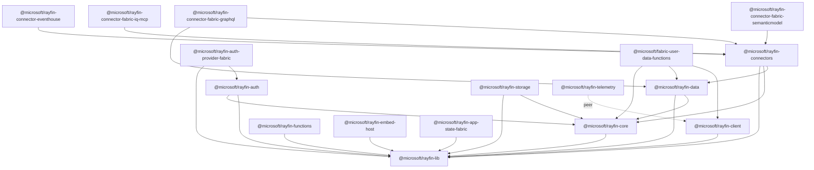

Rayfin packages are split by capability. In 2.0 the application client is assembled from
the capabilities you register, so your app declares each one it uses: the client, an auth
adapter, and the data, functions, connectors, or storage adapters.
[Changed in 2.0](/docs/reference/changelog#rayfin-20)

Keep every `@microsoft/rayfin-*` package — and `@microsoft/fabric-user-data-functions` —
on the same exact version as the CLI.

## Install packages at one version

All `@microsoft/rayfin-*` packages ship in lockstep. Do not mix
`@microsoft/rayfin-client@2.0.0` with `@microsoft/rayfin-core@1.36.2`, or a CLI from a
different Rayfin release. 2.0 client code does not compile against 1.x packages.

A browser app with data, auth, and Fabric sign-in:

```bash
npm install @microsoft/rayfin-core@2.0.0 @microsoft/rayfin-client@2.0.0 @microsoft/rayfin-auth@2.0.0 @microsoft/rayfin-data@2.0.0 @microsoft/rayfin-auth-provider-fabric@2.0.0
```

Add capability packages at the same exact version when you register them:

```bash
npm install @microsoft/rayfin-functions@2.0.0
npm install @microsoft/rayfin-storage@2.0.0
npm install @microsoft/rayfin-connectors@2.0.0
```

The functions project itself depends on `@microsoft/fabric-user-data-functions` at exactly
the CLI version. The 2.0 CLI writes runtime metadata schema 3.0 and refuses to generate
types or deploy with an older worker, printing the `npm install` command to run.
[Changed in 2.0](/docs/reference/changelog#rayfin-20)

## Which package do I need?

| I want to... | Package |
| --- | --- |
| Define entities, fields, relationships, permissions, validation, and storage folders | [`@microsoft/rayfin-core`](/docs/reference/sdk/rayfin-core) |
| Compose one client with `RayfinClient.create`, sign in with a supplied token, or resolve runtime config | [`@microsoft/rayfin-client`](/docs/reference/sdk/rayfin-client) [Changed in 2.0](/docs/reference/changelog#rayfin-20) |
| Register `client.data` and query, mutate, and aggregate entities | [`@microsoft/rayfin-data`](/docs/reference/sdk/rayfin-data) |
| Register `client.auth` with `browserSession()`, inspect sessions, and read claims | [`@microsoft/rayfin-auth`](/docs/reference/sdk/rayfin-auth) |
| Add Microsoft Fabric SSO and direct Entra-token sign-in | [`@microsoft/rayfin-auth-provider-fabric`](/docs/reference/sdk/rayfin-auth-provider-fabric) |
| Register `client.functions` and call Rayfin Functions | [`@microsoft/rayfin-functions`](/docs/reference/sdk/rayfin-functions) |
| Author Rayfin Functions with `udf.func()`, `RayfinContext`, `AudienceType`, and generated types | `@microsoft/fabric-user-data-functions` — documented under [Functions](/docs/functions); no SDK reference page. |
| Route local Functions calls from Vite while `rayfin dev` is running | `@microsoft/rayfin-local-dev` — see [Develop locally](/docs/start/develop-locally). |
| Register `client.storage` to upload, download, list, and delete files | [`@microsoft/rayfin-storage`](/docs/reference/sdk/rayfin-storage) |
| Send browser telemetry to the app's Application Insights resource | [`@microsoft/rayfin-telemetry`](/docs/reference/sdk/rayfin-telemetry) [New in 2.0](/docs/reference/changelog#rayfin-20) [Experimental](/docs/reference/changelog#feature-status) |
| Register `client.connectors` for Fabric SQL sources, semantic models, and other connectors | [`@microsoft/rayfin-connectors`](/docs/reference/sdk/rayfin-connectors) |
| Type a Fabric SQL-backed connector entity | [`@microsoft/rayfin-connector-fabric-graphql`](/docs/reference/sdk/rayfin-connector-fabric-graphql) |
| Type and run a Fabric semantic model connector | [`@microsoft/rayfin-connector-fabric-semanticmodel`](/docs/reference/sdk/rayfin-connector-fabric-semanticmodel) |
| Ask natural-language questions through the Fabric IQ connector | [`@microsoft/rayfin-connector-fabric-iq-mcp`](/docs/reference/sdk/rayfin-connector-fabric-iq-mcp) [New in 2.0](/docs/reference/changelog#rayfin-20) |
| Maintain an existing Eventhouse connector (formerly Kusto) | [`@microsoft/rayfin-connector-eventhouse`](/docs/reference/sdk/rayfin-connector-eventhouse) [Changed in 2.0](/docs/reference/changelog#rayfin-20) [Experimental](/docs/reference/changelog#feature-status) |
| Embed a Rayfin app outside the Fabric portal | [`@microsoft/rayfin-embed-host`](/docs/reference/sdk/rayfin-embed-host) [New in 1.36](/docs/reference/changelog#rayfin-136) |
| Persist app state in Fabric | [`@microsoft/rayfin-app-state-fabric`](/docs/reference/sdk/rayfin-app-state-fabric) |
| Read lower-level HTTP, error, and client-composition types | [`@microsoft/rayfin-lib`](/docs/reference/sdk/rayfin-lib) |

`@microsoft/rayfin-connector-kusto` is not published at 2.0; it was renamed to
`@microsoft/rayfin-connector-eventhouse`. [Removed in 2.0](/docs/reference/changelog#rayfin-20)

## How the packages compose

`@microsoft/rayfin-client` depends only on `@microsoft/rayfin-lib`. Each adapter package
plugs into it through the factory types that `rayfin-lib` defines, and your app wires them
together in `RayfinClient.create`.



`@microsoft/rayfin-core` is mostly build-time: your `rayfin/data/` and `rayfin/storage/`
classes import it so the CLI can generate backend configuration. It declares TypeScript
`^5.7.2 || ^6.0.2` as a peer dependency, the compiler range the CLI uses for schema
compilation. [Changed in 2.0](/docs/reference/changelog#rayfin-20)

The client packages run in the browser, the Functions runtime, Node.js scripts, or a
connector runtime. `@microsoft/fabric-user-data-functions` is the function-authoring
surface documented in the Functions section. `@microsoft/rayfin-local-dev` provides the
Vite adapter that routes local calls under `rayfin dev`.

## Package entry points

Every package now declares an `exports` map, so import only from documented entry points.
Deep imports into `dist/` no longer resolve. [Changed in 2.0](/docs/reference/changelog#rayfin-20)

| Removed in 2.0 | Use instead |
| --- | --- |
| `@microsoft/rayfin-core/experimental` | `@microsoft/rayfin-core` for `blob`, `StorageObject`, `ContentTypes`, `bytes`, `kb`, `mb`, `gb`, the storage option types, and the claims types `RayfinBaseClaims`, `RayfinCustomClaims`, `AllClaims`, `ClientClaims` |
| `@microsoft/rayfin-core/decorators` | `@microsoft/rayfin-core` |
| `@microsoft/rayfin-client/experimental` | `@microsoft/rayfin-client`, plus the adapter packages |
| `@microsoft/rayfin-connector-kusto` | `@microsoft/rayfin-connector-eventhouse` |
| Any `@microsoft/rayfin-*/dist/...` path | The package root or another documented entry point |

`@microsoft/rayfin-local-dev/vite` remains the stable entry point for the Vite adapter.

## Version notes

- Keep the CLI, SDK packages, connector packages, and catalog packages on one Rayfin
  release version.
- Declare every package your code imports. 2.0 apps import `@microsoft/rayfin-auth` and
  `@microsoft/rayfin-data` directly, so they belong in `package.json` even though older
  apps received them through `@microsoft/rayfin-client`.
- Storage is generally available in 2.0 and needs no feature flag.
- Connectors are generally available; `rayfin up connector apply` is still preview, and
  new Eventhouse connectors cannot be added in 2.0.
- When you need the exact signature for the version installed in a project, use
  `rayfin docs get` or `rayfin docs search` from that project root instead of relying on a
  cached API shape.

## In this section

- [`@microsoft/rayfin-core`](/docs/reference/sdk/rayfin-core) — decorators for entities, fields, relationships, permissions, validation, and storage folder declarations.
- [`@microsoft/rayfin-client`](/docs/reference/sdk/rayfin-client) — `RayfinClient.create`, `suppliedToken`, runtime config resolution, disposal, and the 1.x migration map.
- [`@microsoft/rayfin-data`](/docs/reference/sdk/rayfin-data) — `dataService` and the fluent query, aggregation, and mutation API behind `client.data`.
- [`@microsoft/rayfin-auth`](/docs/reference/sdk/rayfin-auth) — `browserSession` and the auth client behind `client.auth`.
- [`@microsoft/rayfin-auth-provider-fabric`](/docs/reference/sdk/rayfin-auth-provider-fabric) — Fabric SSO and direct Entra token sign-in.
- [`@microsoft/rayfin-functions`](/docs/reference/sdk/rayfin-functions) — `functionsService` and typed function calls.
- `@microsoft/fabric-user-data-functions` — function authoring helpers (`udf.func()`, `RayfinContext`, `AudienceType`, type generation); documented under [Functions](/docs/functions), with no `reference/sdk` page.
- `@microsoft/rayfin-local-dev` — the Vite adapter for local routing under `rayfin dev`; see [Develop locally](/docs/start/develop-locally), with no `reference/sdk` page.
- [`@microsoft/rayfin-storage`](/docs/reference/sdk/rayfin-storage) — `storageService` and the typed storage client.
- [`@microsoft/rayfin-telemetry`](/docs/reference/sdk/rayfin-telemetry) — browser telemetry initialization for Observability.
- [`@microsoft/rayfin-connectors`](/docs/reference/sdk/rayfin-connectors) — `connectorsService`, the connector runtime, and typed connector clients.
- [`@microsoft/rayfin-connector-fabric-graphql`](/docs/reference/sdk/rayfin-connector-fabric-graphql) — type-only marker for SQL-backed Fabric connector entities.
- [`@microsoft/rayfin-connector-fabric-semanticmodel`](/docs/reference/sdk/rayfin-connector-fabric-semanticmodel) — semantic model marker, runtime, and result helpers.
- [`@microsoft/rayfin-connector-fabric-iq-mcp`](/docs/reference/sdk/rayfin-connector-fabric-iq-mcp) — Fabric IQ connector marker, runtime, and conversation wrapper.
- [`@microsoft/rayfin-connector-eventhouse`](/docs/reference/sdk/rayfin-connector-eventhouse) — Eventhouse connector support for existing projects.
- [`@microsoft/rayfin-embed-host`](/docs/reference/sdk/rayfin-embed-host) — external embed host SDK.
- [`@microsoft/rayfin-app-state-fabric`](/docs/reference/sdk/rayfin-app-state-fabric) — Fabric app state SDK.
- [`@microsoft/rayfin-lib`](/docs/reference/sdk/rayfin-lib) — shared HTTP client, errors, and client-composition types.
